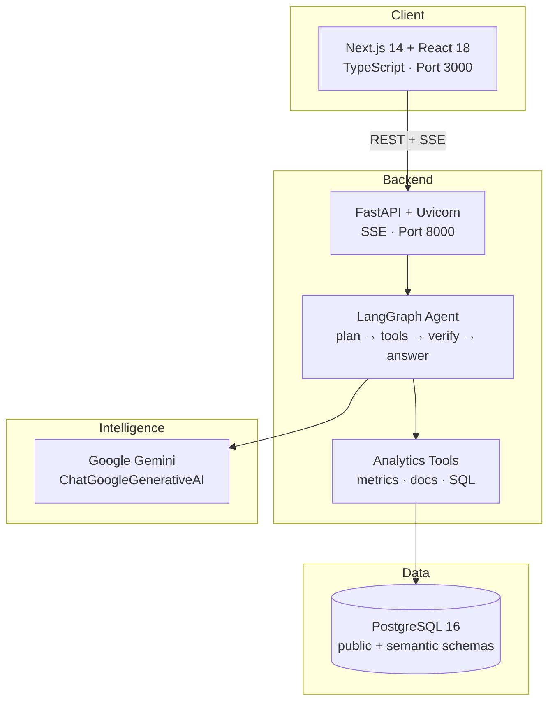
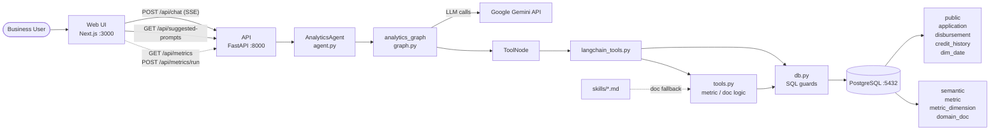
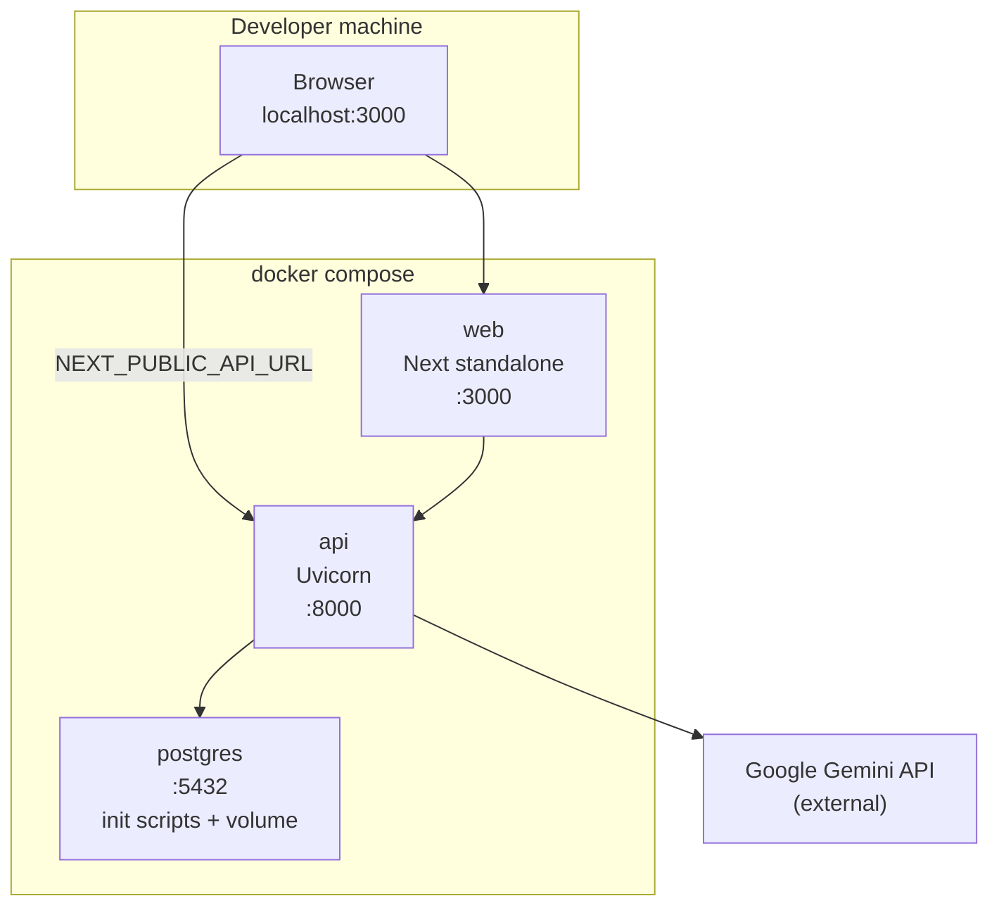
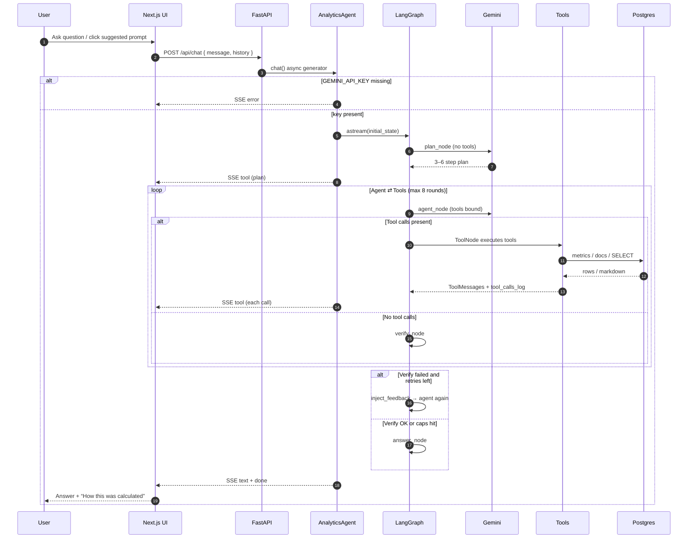
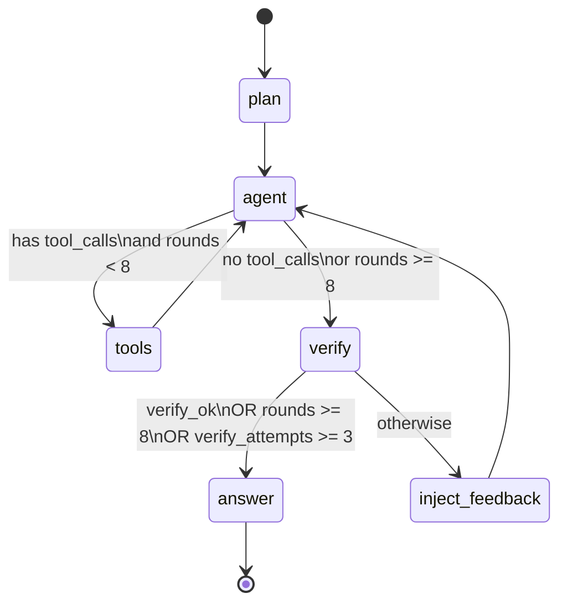
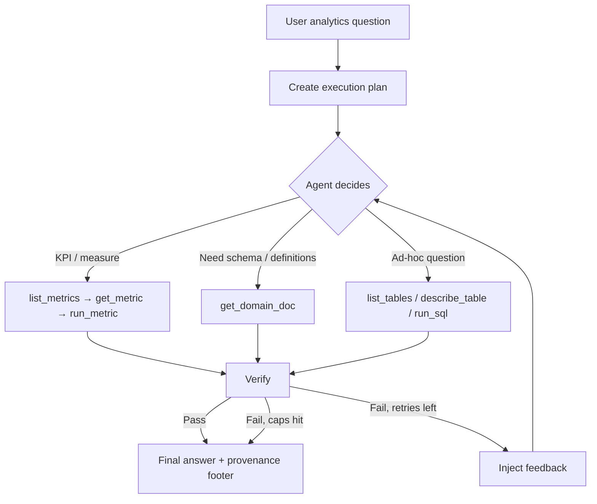
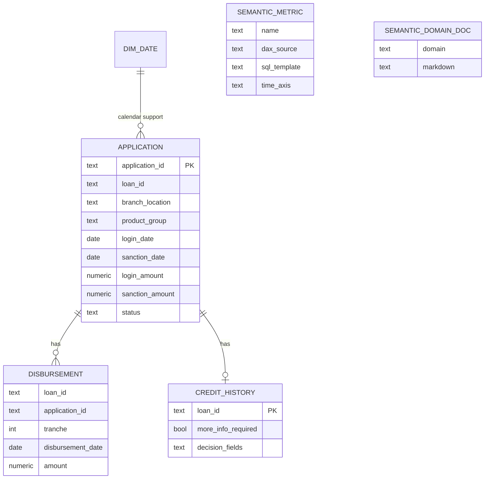

# Loan Analytics Agent POC — Presentation Documentation

**Self-service analytics chat for education loan origin data**  
Governed metrics first · Curated domain docs · Read-only SQL fallback · LangGraph + Google Gemini

| Item | Detail |
|------|--------|
| **POC name** | Loan Analytics Agent |
| **Pattern** | Agentic analytics (metrics → docs → SQL) |
| **Runtime** | Docker Compose (Postgres + API + Web) |
| **UI** | http://localhost:3000 |
| **API** | http://localhost:8000 |

---

## 1. Executive summary

This POC lets business users ask natural-language questions about education-loan pipeline KPIs (logins, sanctions, disbursements, CM review status) and get answers with **provenance** — which metric or SQL was used, and for which date window.

Design principle: **prefer governed semantic metrics** (aligned with Power BI DAX) over ad-hoc SQL, so numbers stay consistent with existing BI definitions.

---

## 2. Problem & solution

| Challenge | Approach in this POC |
|-----------|----------------------|
| Business users depend on analysts for KPI answers | Chat UI with suggested prompts |
| Raw LLM SQL can invent wrong measures | Semantic metric layer (DAX → SQL templates) |
| Unbounded agent loops / wrong answers | LangGraph plan → tools → **verify** → answer |
| Unsafe DB access | Read-only SELECT sandbox + table allowlist |
| Opaque “black box” answers | SSE tool events + “How this was calculated” panel |

---

## 3. Tech stack

### 3.1 Layered view

| Layer | Technology | Version / notes |
|-------|------------|-----------------|
| **Frontend** | Next.js (App Router), React, TypeScript | Next 14.2.18 · React 18.3.1 · TS 5.6.3 |
| **API** | FastAPI, Uvicorn, SSE (sse-starlette) | FastAPI 0.115.6 · Uvicorn 0.32.1 |
| **Agent** | LangGraph + LangChain Core | LangGraph 1.2.12 · langchain-core 1.6.4 |
| **LLM** | Google Gemini via `langchain-google-genai` | Primary: `gemini-3.5-flash-lite` + fallbacks |
| **Database** | PostgreSQL | 16-alpine |
| **DB driver** | psycopg2-binary | 2.9.10 |
| **Config** | pydantic-settings, python-dotenv | — |
| **Orchestration** | Docker Compose | 3 services + named volume |
| **Runtime images** | Python 3.12-slim · Node 20-alpine | — |

### 3.2 Stack diagram



### 3.3 Key libraries (API)

| Package | Role |
|---------|------|
| `langgraph` | State machine / agent graph |
| `langchain-google-genai` | Gemini chat model + tool binding |
| `sse-starlette` | Server-Sent Events for chat streaming |
| `psycopg2-binary` | Postgres connectivity |
| `pydantic-settings` | Env-based configuration |

---

## 4. Architecture

### 4.1 High-level system architecture



### 4.2 Component responsibilities

| Component | Location | Responsibility |
|-----------|----------|----------------|
| **Web chat UI** | `web/app/page.tsx` | Chat, suggested prompts, SSE client, provenance panel |
| **API gateway** | `api/app/main.py` | Health, metrics APIs, SSE chat endpoint, CORS |
| **Agent facade** | `api/app/agent/agent.py` | History → graph state; emits SSE (`tool` / `text` / `done` / `error`) |
| **LangGraph graph** | `api/app/agent/graph.py` | Plan, agent↔tools loop, verify, feedback retry, answer |
| **Tool wrappers** | `api/app/agent/langchain_tools.py` | 7 LangChain `@tool`s bound to Gemini |
| **Business logic** | `api/app/agent/tools.py` | List/get/run metrics; domain doc lookup |
| **DB layer** | `api/app/db.py` | Connections, allowlist, read-only SQL validation, limits |
| **Semantic + seed** | `db/init/*.sql` | Schema, metrics, ~300 synthetic apps, domain docs |
| **Evals** | `api/evals/` | Offline metric/SQL checks against seed (no LLM) |

### 4.3 Deployment topology (Docker Compose)



| Service | Image / build | Port | Depends on |
|---------|---------------|------|------------|
| `postgres` | `postgres:16-alpine` | 5432 | — |
| `api` | `./api` (Python 3.12) | 8000 | healthy postgres |
| `web` | `./web` (Node 20) | 3000 | api |

---

## 5. Flow diagrams

### 5.1 End-to-end user request flow



### 5.2 LangGraph state machine



### 5.3 Decision policy inside the agent



### 5.4 Metrics-first query path (happy path)

1. User asks: *“What were Logins (LD) in March 2025?”*
2. **plan** resolves window `2025-03-01` → `2025-03-31` and prefers metric `Logins (LD)`.
3. **agent** calls `list_metrics` / `run_metric`.
4. **tools** execute the SQL template from `semantic.metric` against Postgres.
5. **verify** confirms tools were used and answer includes `Source:` footer.
6. UI shows the number plus tool provenance.

---

## 6. Agent tools

| Tool | Purpose |
|------|---------|
| `list_metrics` | Search governed DAX-aligned metrics |
| `get_metric` | Full metric definition (DAX + SQL template) |
| `run_metric` | Execute metric for a date range (optional `group_by`) |
| `get_domain_doc` | Domain reference markdown |
| `list_tables` | List allowlisted tables |
| `describe_table` | Column metadata for an allowed table |
| `run_sql` | Read-only SELECT when no metric applies |

**Group-by dimensions:** `branch_location`, `product_group`.

---

## 7. Data & semantic layer

### 7.1 Logical data model



### 7.2 Seeded governed metrics

| Metric | Time axis |
|--------|-----------|
| Logins (LD) | `login_date` |
| Loan Amount (LD) | `login_date` |
| Sanctions (All) | `sanction_date` |
| Sanction Amount (All) | `sanction_date` |
| First Disbursed (All) | `disbursement_date` (tranche = 1) |
| First Disbursed Amount (All) | `disbursement_date` (tranche = 1) |
| CM Review More Info Required | snapshot |
| Under CM Review | snapshot |

DAX text is stored for **lineage**; runtime execution uses parameterized **SQL templates**.

### 7.3 Application statuses (seed)

`logged` · `under_cm_review` · `credit_declined` · `customer_declined` · `sanctioned` · `disbursement_review` · `first_disbursed`

---

## 8. API surface

| Method | Path | Description |
|--------|------|-------------|
| `GET` | `/health` | DB ping + whether Gemini is configured |
| `GET` | `/api/metrics?q=` | List / search metrics (no LLM) |
| `POST` | `/api/metrics/run` | Run a governed metric (no LLM) |
| `POST` | `/api/chat` | SSE agent chat |
| `GET` | `/api/suggested-prompts` | Example questions for the UI |

### SSE event types

| Type | Payload (conceptually) |
|------|------------------------|
| `tool` | `{ tool, args }` — plan or tool invocation |
| `text` | `{ content }` — final answer |
| `done` | `{ tool_calls }` — session tool log for UI |
| `error` | `{ content }` — failure message |

---

## 9. Safety & governance controls

| Control | Implementation |
|---------|----------------|
| Metrics before SQL | System prompt + plan prompt + verify KPI hint |
| Read-only SQL | SELECT-only; blocked DML/DDL keywords; no multi-statements |
| Table allowlist | `application`, `disbursement`, `credit_history`, `dim_date`, `semantic.*` |
| Resource limits | `statement_timeout` 10s · max 500 rows |
| Loop caps | Max 8 tool rounds · max 3 verify attempts |
| Provenance | Required `Source: …` footer on every answer |
| PII guidance | Prompt policy: do not expose email / mobile / PAN / passport |
| Model resilience | Gemini primary + fallback chain on quota / 429 |

---

## 10. Project layout

```
AI POC/
├── docker-compose.yml
├── .env.example
├── README.md
├── docs/
│   └── POC_PRESENTATION.md      ← this document
├── db/init/
│   ├── 01_schema.sql            # operational tables + dim_date
│   ├── 02_semantic.sql          # metrics + dimensions
│   ├── 03_seed.sql              # synthetic applications
│   └── 04_docs.sql              # domain_doc content
├── api/
│   ├── Dockerfile
│   ├── requirements.txt
│   ├── app/
│   │   ├── main.py
│   │   ├── config.py
│   │   ├── db.py
│   │   ├── agent/
│   │   │   ├── agent.py         # SSE facade
│   │   │   ├── graph.py         # LangGraph
│   │   │   ├── langchain_tools.py
│   │   │   └── tools.py
│   │   └── skills/              # markdown domain docs (fallback)
│   └── evals/
│       ├── questions.json
│       └── run_evals.py
└── web/
    ├── Dockerfile
    ├── package.json
    └── app/
        ├── page.tsx             # chat UI
        ├── layout.tsx
        └── globals.css
```

---

## 11. Configuration & demo setup

### Environment variables

| Variable | Purpose |
|----------|---------|
| `GEMINI_API_KEY` | Required for chat |
| `GEMINI_MODEL` | Primary model (default `gemini-3.5-flash-lite`) |
| `GEMINI_MODEL_FALLBACKS` | Comma-separated fallbacks on quota errors |
| `DATABASE_URL` | Postgres connection string |
| `CORS_ORIGINS` | Allowed browser origins (default `http://localhost:3000`) |
| `NEXT_PUBLIC_API_URL` | Browser → API base URL |

### Quick start (demo)

```bash
cp .env.example .env
# set GEMINI_API_KEY=...

docker compose up --build
```

| URL | Use |
|-----|-----|
| http://localhost:3000 | Chat UI |
| http://localhost:8000/health | Health check |

### Example demo questions

- What were Logins (LD) in March 2025?
- Show Sanction Amount (All) by branch for Q2 2025
- How many applications are credit declined in Q1 2025?
- Loans under CM review with more info required

**Timezone for relative dates:** Asia/Kolkata (calendar months).  
**Demo “today” for relative queries:** data through **2025-08-31** (matches seed window).

---

## 12. Design decisions (talking points)

1. **Governed metrics over free-form SQL** — keeps answers aligned with Power BI DAX measures.
2. **Explicit plan step** — forces date-window and metric preference before tool use.
3. **Verification gate** — KPI questions must use tools; answers must include provenance.
4. **Dual documentation** — `semantic.domain_doc` in DB, with filesystem `skills/` as fallback.
5. **Offline evals** — seed-pinned metric/SQL regression without calling the LLM.
6. **SSE (not WebSockets)** — simple one-way streaming of plan/tools/final answer to the browser.

---

## 13. POC scope & limitations

| In scope | Out of scope (current POC) |
|----------|----------------------------|
| Single-page analytics chat | Auth, multi-user sessions, conversation persistence |
| Synthetic ~300-row seed | Production data / real PII scrubbing pipeline |
| Final answer after graph completes | Token-by-token LLM streaming |
| Tool args in UI provenance | Full tool result payloads in the UI |
| Name-based SQL allowlist | Full SQL AST sandbox |
| Local Docker Compose | Cloud deploy / observability stack |

---

## 14. Suggested presentation outline (10–15 min)

| Slide / section | Content |
|-----------------|--------|
| 1 | Problem: self-serve loan KPI answers without broken measures |
| 2 | Solution snapshot + live UI screenshot |
| 3 | **Tech stack** (table in §3) |
| 4 | **Architecture diagram** (§4.1) |
| 5 | **LangGraph flow** (§5.2) + sequence (§5.1) |
| 6 | Semantic metrics & DAX lineage (§7) |
| 7 | Safety / governance (§9) |
| 8 | Live demo (2–3 questions) |
| 9 | Eval approach + next steps |

---

## 15. Next-step ideas (optional roadmap)

- Persist chat history and user sessions  
- Token streaming for perceived latency  
- Richer provenance (show metric SQL + row samples)  
- Auth + audit log of questions and sources  
- Expand metric catalog and real (scrubbed) datasets  
- Hosted deployment with managed Postgres + secret store  

---

*Generated from the Loan Analytics Agent POC codebase. Diagrams are Mermaid — render in GitHub, GitLab, Notion, Confluence, or any Mermaid-compatible viewer / slide tool.*
